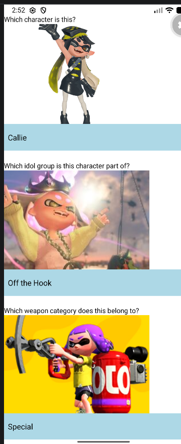
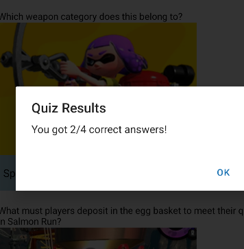

# Splatoon Trivia Quiz

Splatoon Trivia Quiz is a mobile quiz application developed using React Native and Expo. It tests players' knowledge of the Splatoon video game series through image-based multiple-choice questions covering characters, idol groups, weapons, and Salmon Run gameplay.

# Features Highlight

- **Four Trivia Questions:** Players answer four different questions about the Splatoon series.
- **Image-Based Questions:** Each question displays an image to help players identify the correct answer.
- **Dropdown Selection:** Uses the `Picker` component to provide multiple-choice answers.
- **Reusable Custom Component:** Uses a `QuizQuestion` component with props to display different questions without repeating code.
- **State Management:** Uses `useState` to store each player's selected answers.
- **Answer Validation:** Uses conditional statements and logical OR (`||`) to prevent users from submitting incomplete quizzes.
- **Automatic Score Calculation:** Checks answers and calculates the player's total score out of four.
- **Quiz Results:** Uses `Alert.alert()` to display the final score.
- **Scrollable Interface:** Uses `ScrollView` to allow players to navigate through all questions.
- **Interactive Submit Button:** Uses `TouchableOpacity` to submit answers.

# ScreenShots of App

Screenshots:

# Demo Video

Demo Video Link:
[Screen Recording 2026-11-05 104847.mp4](Video/Screen%20Recording%202026-11-05%20104847.mp4)
